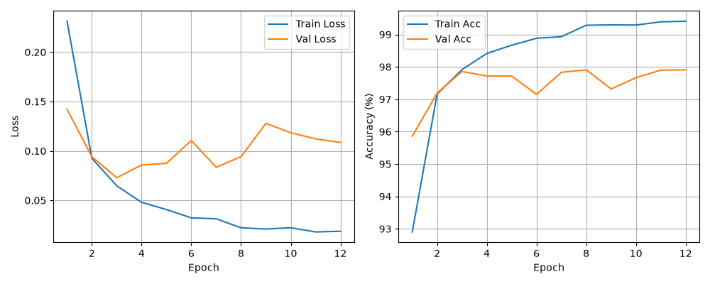
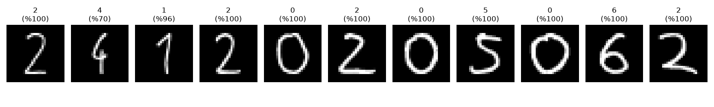

# MNIST ile MLP Tabanlı El Yazısı Rakam Tanıma

Bu ödevde MNIST veri setini kullanarak sıfırdan bir MLP (Multi-Layer Perceptron) modeli eğittim ve ardından modeli kendi el yazımla yazdığım öğrenci numaram (`24120205062`) üzerinde denedim.

## 1. Veri Seti ve Eğitim Hazırlığı

MNIST veri setindeki 60.000 eğitim görüntüsünü modelin eğitim sürecini takip edebilmek için ikiye ayırdım:
* **Train Seti:** 48.000 görüntü (%80)
* **Validation Seti:** 12.000 görüntü (%20)
* **Test Seti:** 10.000 görüntü

Test verisini eğitim ve hiperparametre seçimi sırasında modele hiç göstermedim, sadece eğitim tamamen bittikten sonra modelin genel başarısını görmek için kullandım. Görüntüleri modele vermeden önce tensöre çevirip MNIST'in standart ortalama (`0.1307`) ve standart sapma (`0.3081`) değerleriyle normalize ettim.

## 2. Model Mimarisi ve Hiperparametreler

Ödev kapsamında CNN kullanılmaması gerektiği için sadece `nn.Linear` katmanlarından oluşan, 2 gizli katmanlı bir yapı kurdum. 28x28 boyutundaki gri seviye görüntüleri önce `Flatten` katmanıyla 784 elemanlı düz bir vektöre çevirdim. Ardından sırasıyla 512 ve 256 nöronlu iki gizli katmandan geçirdim. Gizli katmanlarda aktivasyon fonksiyonu olarak **ReLU** kullandım. Çıkış katmanında ise 0-9 arası rakamları temsil eden 10 nöron bulunuyor.

Kullandığım hiperparametreler:
* **Mimari:** 784 -> 512 -> 256 -> 10
* **Aktivasyon Fonksiyonu:** ReLU
* **Loss Fonksiyonu:** CrossEntropyLoss
* **Optimizer:** Adam
* **Learning Rate:** 0.001
* **Batch Size:** 64
* **Epoch Sayısı:** 12

## 3. Eğitim Sonuçları

Modeli 12 epoch boyunca eğittiğimde elde ettiğim sonuçlar şu şekilde çıktı:

* **Training Loss (Son Epoch):** 0.0187
* **Validation Loss (Son Epoch):** 0.1086
* **Training Accuracy (Son Epoch):** %99.41
* **Validation Accuracy (Son Epoch):** %97.91
* **Test Accuracy:** %97.85
* **Toplam Eğitim Süresi:** 40.33 saniye

12 epoch sonunda eğitim ve doğrulama doğrulukları birbirine yakın seyretti, ciddi bir overfitting durumu yaşanmadan test setinde **%97.85** doğruluk elde ettim.

### Loss ve Accuracy Grafikleri



## 4. Kendi El Yazım Üzerinde Test ve Değerlendirme

Eğitim bittikten sonra kendi öğrenci numaram olan `24120205062` rakamlarını boş bir kağıda yazıp fotoğrafını çektim ve her bir rakamı tek tek kırparak `my_digits` klasörüne ekledim.

### Yaşadığım Sorun ve Dağılım Kayması (Distribution Shift)

İlk denememde kırptığım fotoğrafları sadece gri tona çevirip, renklerini tersleyip (`invert`) doğrudan 28x28 boyutuna küçülterek modele verdim. Model MNIST test setinde %97.85 almasına rağmen benim el yazım olan rakamların neredeyse hepsini yanlış tahmin etti.

Görselleri incelediğimde eğitim verisi ile kendi çektiğim fotoğraflar arasındaki farkı (distribution shift) net şekilde gözlemledim:
1. Telefonla çekilen fotoğrafta kağıt tam beyaz olmadığı ve üzerinde hafif gölgeler kaldığı için, renkleri ters çevirdiğimde arka plan MNIST'teki gibi tam siyah (`0`) olmak yerine grimsi bir tonda kaldı. Bu gürültü pikselleri doğrudan MLP'nin giriş ağırlıklarını yanılttı.
2. Kalemle yazdığım çizgiler 28x28'e küçülünce MNIST'teki kalın fırça darbelerine göre çok ince ve silik kaldı.
3. MNIST'teki rakamlar 28x28 karenin içindeki 20x20'lik merkez alana ortalanmış durumda. MLP mimarisi CNN gibi uzamsal (spatial) özellikleri koruyamadığı için rakamın kenarlara yakın olması bile tahminleri bozdu.

### Ön İşleme ile Çözüm ve Sonuçlar

Görüntüleri MNIST formatına tam benzetmek için `test_numara.py` içinde OpenCV kullanarak şu adımları uyguladım:
* **Gaussian Blur ve Otsu Thresholding** ile kağıttaki gölgeleri temizleyip arka planı tamamen siyah (`0`), rakamları ise tamamen beyaz (`255`) yaptım.
* **Dilation** işlemiyle ince kalem çizgilerini biraz kalınlaştırdım.
* Rakamın etrafındaki fazlalıkları kırpıp kare içine ortaladım, `20x20` boyuta küçülttüm ve kenarlarına 4'er piksel siyah boşluk (padding) ekleyerek `28x28` boyutuna (`mnist_format_digits` klasörü) getirdim.

Bu ön işlemden sonra modeli tekrar çalıştırdığımda öğrenci numaramdaki 11 rakamın tamamını doğru tahmin etti. Sadece ikinci sıradaki `4` rakamında el yazımın şeklinden dolayı güven oranı %70.2 civarında kaldı, diğer tüm rakamları %95 ile %100 arasında güvenle bildi.



| Dosya | Gerçek Rakam | Model Tahmini | Güven Oranı |
| :--- | :---: | :---: | :---: |
| `01.jpg` | 2 | 2 | %100.0 |
| `02.jpg` | 4 | 4 | %70.2 |
| `03.jpg` | 1 | 1 | %95.5 |
| `04.jpg` | 2 | 2 | %100.0 |
| `05.jpg` | 0 | 0 | %100.0 |
| `06.jpg` | 2 | 2 | %100.0 |
| `07.jpg` | 0 | 0 | %100.0 |
| `08.jpg` | 5 | 5 | %100.0 |
| `09.jpg` | 0 | 0 | %100.0 |
| `10.jpg` | 6 | 6 | %100.0 |
| `11.jpg` | 2 | 2 | %100.0 |

## 5. Çalıştırma

Kütüphaneleri kurmak için:
```bash
pip install -r requirements.txt
```

Modeli eğitmek için:
```bash
python3 train.py
```

El yazısı öğrenci numarasını test etmek için:
```bash
python3 test_numara.py
```


